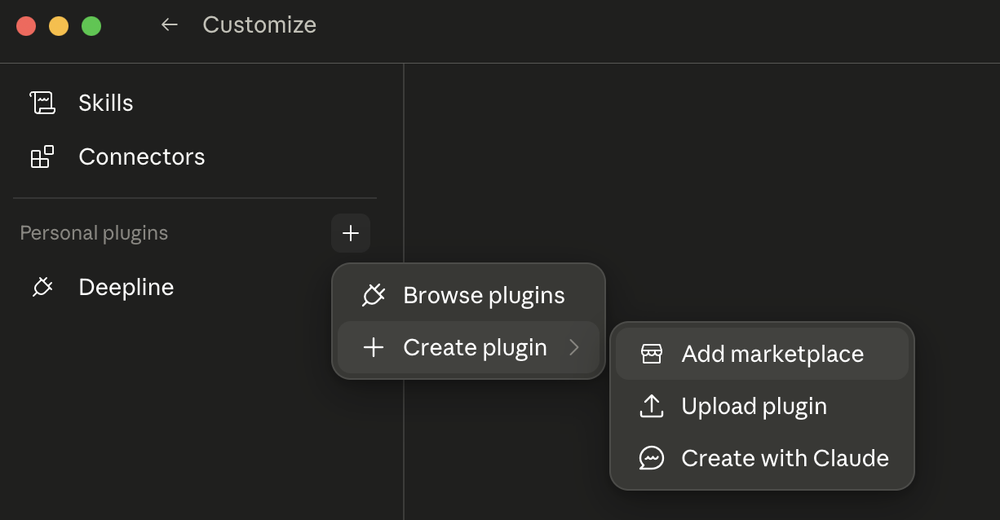
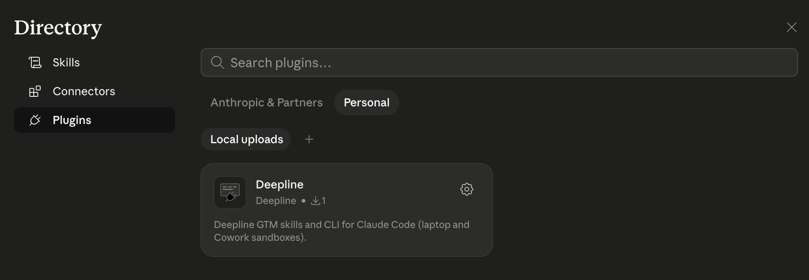
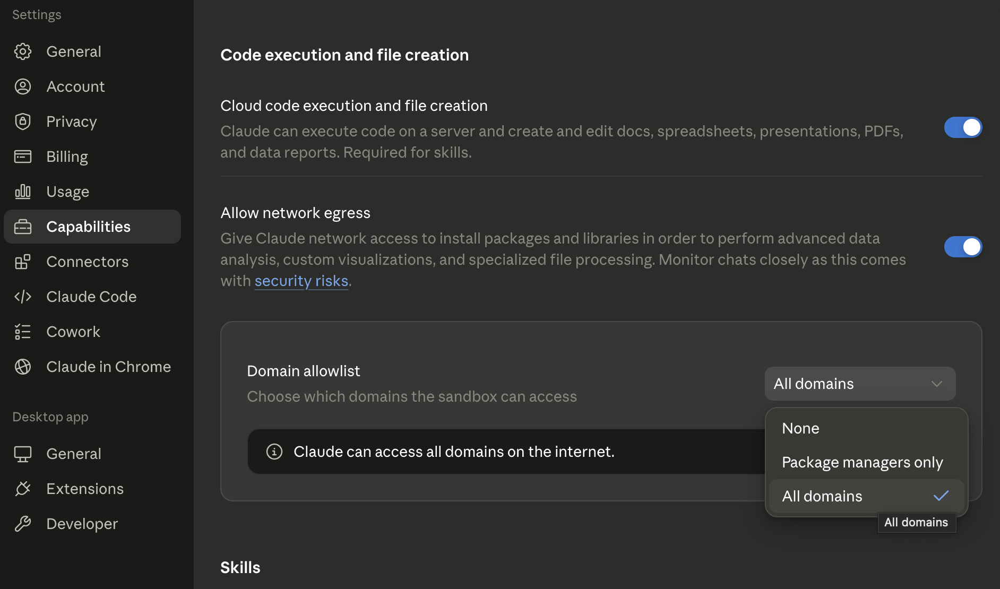
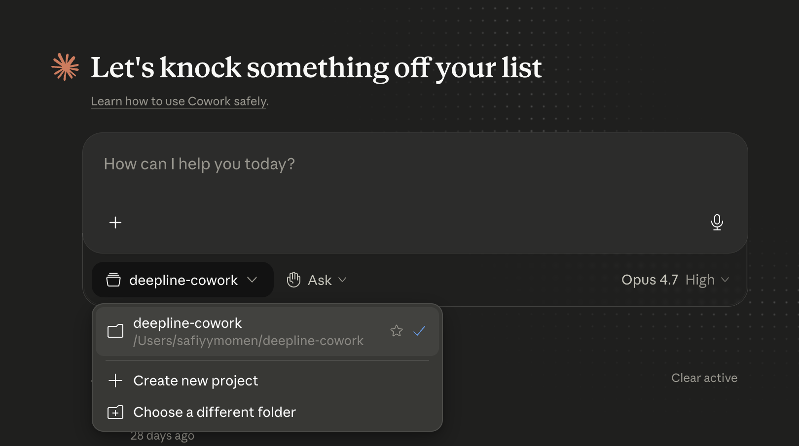
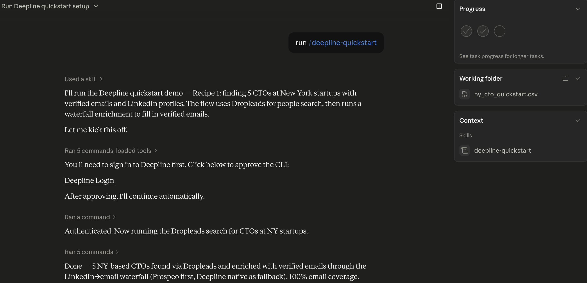

# Deepline Skills Plugin

Deepline adds GTM skills to Claude Cowork and Claude Code. Use them to build prospect lists, enrich CSVs, research accounts, write outbound, and run Deepline workflows from Claude.

The plugin is a skills bundle: it runs no local code at install. Each skill includes the Deepline CLI setup commands, and the CLI talks to your Deepline workspace. Start with `/deepline-quickstart`; `/deepline-gtm` covers most prospecting, enrichment, and Play work.

## Install In Claude Cowork

In Cowork, add Deepline as a personal plugin:

1. Open Claude Desktop and switch to **Cowork**.
2. Open **Customize** in the left sidebar.
3. Click the **+** next to **Personal plugins**.
4. Open **Create plugin**, then choose **Add marketplace**.



5. Add a personal/custom plugin from this GitHub repository:

   ```text
   https://github.com/getaero-io/deepline-plugins
   ```

6. Install the `deepline` plugin.



7. Enable internet access for **all domains** in the Cowork session settings: open **Settings** -> **Capabilities**, turn on **Allow network egress**, then set **Domain allowlist** to **All domains**.



8. Start a Cowork session and select a project folder.



Selecting a folder lets Deepline persist auth in that workspace, so future Cowork sessions opened on the same folder can reuse the saved auth.

9. Run:

   ```text
   /deepline-quickstart
   ```



If the CLI is not installed yet, have Claude follow https://code.deepline.com/INSTALL.md so it selects the command for the local npm version. For manual recovery on npm older than 11.16, run:

```bash
npm install -g deepline@latest
# Fallback for secure sandboxes: mkdir -p "$HOME/.local" && npm config set prefix "$HOME/.local" && export PATH="$HOME/.local/bin:$PATH" && npm install -g deepline@latest --registry https://code.deepline.com/api/v2/npm/
deepline setup --json
deepline auth wait --timeout 120 # only if you approved in the browser after setup returned; no-op if already connected
```

Team and Enterprise plans: your organization owner may need to enable Cowork for the workspace. They may also need to allow internet access for all domains, or add the domains you use, in Cowork's network settings. See [Use Claude Cowork on Team and Enterprise plans](https://support.claude.com/en/articles/13455879-use-claude-cowork-on-team-and-enterprise-plans).

## Install In Claude Code

Inside Claude Code, run:

```text
/plugin marketplace add getaero-io/deepline-plugins
/plugin install deepline@deepline
/reload-plugins
```

Then try:

```text
/deepline-quickstart
```

If the CLI is not installed yet, have Claude follow https://code.deepline.com/INSTALL.md so it selects the command for the local npm version. For manual recovery on npm older than 11.16, run:

```bash
npm install -g deepline@latest
# Fallback for secure sandboxes: mkdir -p "$HOME/.local" && npm config set prefix "$HOME/.local" && export PATH="$HOME/.local/bin:$PATH" && npm install -g deepline@latest --registry https://code.deepline.com/api/v2/npm/
deepline setup --json
deepline auth wait --timeout 120 # only if you approved in the browser after setup returned; no-op if already connected
```

## Auth

If Deepline asks you to authenticate, ask Claude to run:

```bash
deepline setup --json
```

`deepline setup` registers this machine and prints or opens the approval link.
Approve the workspace you intend to use, and keep the same project folder
afterwards. In Cowork, setup returns before you approve; once you have approved
in the browser, finish with:

```bash
deepline auth wait --timeout 120 # no-op if already connected
```

## Verify

Ask Claude to run:

```bash
command -v deepline
deepline --version
deepline auth status --json
```

The first two commands check that the CLI is installed. The last one checks
which workspace you are authorized for; a version string alone does not prove
workspace access. If setup fails, run `deepline doctor --json` and follow the
next action it reports.

## Where Data Goes

The plugin declares no connectors. Its skills send data only through the
Deepline CLI to Deepline at `code.deepline.com`, which runs your requests
against Deepline's data providers. The provider list ships in the
`deepline-gtm` skill. Results are saved in your project folder and in your
Deepline workspace. See the [privacy policy](https://deepline.com/privacy) for
how Deepline handles and retains data.

## Support

- [Deepline plugin docs](https://deepline.com/docs/claude-plugins)
- [Deepline Cowork guide](https://deepline.com/docs/claude-cowork)
- [Contact Deepline](https://deepline.com/contact)
- [Privacy policy](https://deepline.com/privacy) · [Terms of service](https://deepline.com/terms)

## References

- [Deepline plugin repository](https://github.com/getaero-io/deepline-plugins)
- [Use plugins in Claude Cowork](https://support.claude.com/en/articles/13837440-use-plugins-in-claude-cowork)
- [Claude Code plugin docs](https://code.claude.com/docs/en/discover-plugins)

## License

MIT
